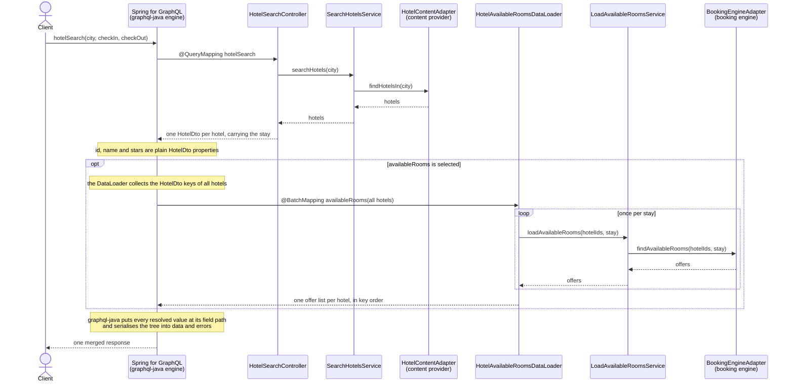

# 🏨 Combining Multiple Data Sources in One Spring-for-GraphQL Query 🌐

This example shows how a single GraphQL query returns one nested result built from **independent data sources**. Each
source is only asked when its fields are selected. Lists are loaded in bulk instead of once per item, and the fields of
a single object are loaded from different sources in parallel.

## ✨ Use-Case

A hotel platform. It combines three systems that are separated in practice:

| Data source                                     | Owns                                        | Characteristics                                   |
|-------------------------------------------------|---------------------------------------------|---------------------------------------------------|
| **Content provider** (`HotelContentAdapter`)    | `id`, `name`, `stars`                       | master data, changes rarely, cheap to read        |
| **Booking engine** (`BookingEngineAdapter`)     | `availableRooms`                            | availability & prices for a stay, volatile, expensive (rate-limited API) |
| **Review platform** (`ReviewPlatformAdapter`)   | `rating`, `reviews`                         | external platform, independent of the other two   |

All sources are linked by the hotel id. Two queries cover the two screens every hotel platform has:

| Query                              | Screen        | Shape                                         | Technique                                    |
|------------------------------------|---------------|-----------------------------------------------|----------------------------------------------|
| `hotelSearch(city, checkIn, checkOut)` | result list | many hotels, one expensive field each       | `@BatchMapping`: one call for all hotels     |
| `hotel(id)`                        | detail page   | one hotel, each property from its own source  | `@SchemaMapping` per field, in parallel      |

All sources are deterministic in-memory fakes. This is a deliberate demo setup: no external accounts, no extra
infrastructure, and no GraphQL federation, because all sources are aggregated behind one schema in one service.

## 🚀 Run it

```bash
# start the application (GraphiQL: http://localhost:8083/graphiql)
./gradlew :examples:spring-for-graphql-multiple-data-sources:bootRun

# run the tests (GraphQL slice tests, integration test, architecture suite)
./gradlew :examples:spring-for-graphql-multiple-data-sources:test

# run the Bruno e2e collection against the running app
cd examples/spring-for-graphql-multiple-data-sources/bruno && npx --yes @usebruno/cli run . --env Local
```

## 🧱 Hexagonal structure

Every source sits behind its own outbound port, and every GraphQL resolver talks to exactly one use-case. The
architecture suite (`ArchitectureTest`) enforces this, so a resolver can never reach into a second source.

| Inbound adapter (GraphQL)                                              | Inbound port              | Service                     | Outbound port          | Outbound adapter (source) |
|------------------------------------------------------------------------|---------------------------|-----------------------------|------------------------|---------------------------|
| `HotelSearchController`                                                | `SearchHotelsQuery`       | `SearchHotelsService`       | `HotelContentPort`     | `HotelContentAdapter`     |
| `HotelDetailsController`                                               | `LoadHotelQuery`          | `LoadHotelService`          | `HotelContentPort`     | `HotelContentAdapter`     |
| `HotelAvailableRoomsDataLoader`, `HotelDetailsAvailableRoomsController` | `LoadAvailableRoomsQuery` | `LoadAvailableRoomsService` | `RoomAvailabilityPort` | `BookingEngineAdapter`    |
| `HotelReviewsController`                                               | `LoadHotelReviewsQuery`   | `LoadHotelReviewsService`   | `ReviewPlatformPort`   | `ReviewPlatformAdapter`   |

Both queries reuse the same `LoadAvailableRoomsQuery` use-case and only differ in the GraphQL adapter in front of it.
Replacing an in-memory fake with a real HTTP client only touches its outbound adapter.

Spring for GraphQL registers every annotated controller method as a graphql-java `DataFetcher` for one schema field.
graphql-java walks the selection set, calls these fetchers and assembles the response tree. The controllers only
return parts of it.

## 🔎 Query 1: `hotelSearch`, the result list

```graphql
query hotelSearch($city: String!, $checkIn: String!, $checkOut: String!) {
  hotelSearch(city: $city, checkIn: $checkIn, checkOut: $checkOut) {
    name
    stars
    availableRooms {
      roomType
      pricePerNightInEuro
      totalPriceInEuro
    }
  }
}
```

```json
{ "city": "München", "checkIn": "2026-12-11", "checkOut": "2026-12-13" }
```

```json
{
  "data": {
    "hotelSearch": [
      {
        "name": "Hotel Bayerischer Hof",
        "stars": 5,
        "availableRooms": [
          { "roomType": "Doppelzimmer", "pricePerNightInEuro": 320, "totalPriceInEuro": 640 },
          { "roomType": "Suite", "pricePerNightInEuro": 890, "totalPriceInEuro": 1780 }
        ]
      },
      {
        "name": "Hotel Isarblick",
        "stars": 3,
        "availableRooms": [
          { "roomType": "Einzelzimmer", "pricePerNightInEuro": 95, "totalPriceInEuro": 190 }
        ]
      },
      {
        "name": "Pension am Viktualienmarkt",
        "stars": 2,
        "availableRooms": []
      }
    ]
  }
}
```

The application log shows a single call to the booking engine for all three hotels:

```
BookingEngineAdapter : Booking engine requested for 3 hotel(s) and Stay(checkIn=2026-12-11, checkOut=2026-12-13)
```

Remove `availableRooms` from the query and that log line disappears.

### Data flow



1. `@QueryMapping hotelSearch` only loads the hotels. It does **not** build the full result upfront.
2. Spring for GraphQL resolves every selected field of `Hotel`. `id`, `name` and `stars` are plain properties of
   `HotelDto`.
3. `availableRooms` is not a property of `HotelDto`. It is resolved by the `@BatchMapping` method, which receives
   **all** hotels of the response at once, asks the booking engine with all hotel ids and returns one list of offers per
   hotel, in the same order as the hotels it received.

### `@QueryMapping`, `@SchemaMapping` and `@BatchMapping`

- `@QueryMapping` is a shortcut for `@SchemaMapping(typeName = "Query")` and resolves a root field.
- `@SchemaMapping(typeName = "Hotel", field = "availableRooms")` would resolve the field **once per hotel**:
  n hotels → n calls to the booking engine.
- `@BatchMapping(typeName = "Hotel", field = "availableRooms")` registers a `DataLoader` under the hood and resolves
  the field **once for all hotels** of a request. It is an *alternative* to `@SchemaMapping` for that field, so never
  put both on the same field.

`typeName` is set explicitly because the Kotlin class is called `HotelDto` while the GraphQL type is called `Hotel`.

### Why not assemble everything in the root resolver?

The root resolver could call both sources and return complete objects. It would then always call the booking engine,
even for a query that never selects `availableRooms`. With field-level resolution the data access follows the
**selection** of the client: no `availableRooms` in the query, no booking engine call.

### Why the stay is part of the root query and the batch key

A `@BatchMapping` method only receives the parent objects. It has **no access to field arguments**, because one batch
may contain keys from different places in the query. That is why the stay is an argument of `hotelSearch` (like on any
hotel website) and travels along inside the parent `HotelDto`.

`HotelDto` is the `DataLoader` key, so its `equals`/`hashCode` include the stay. If two aliased searches with different
dates are part of the same query, the same hotel appears as two different keys, and `HotelAvailableRoomsDataLoader`
groups the keys by stay: one booking engine call per stay. `HotelSearchControllerTest` covers this case.

The batch method returns a `List` in key order instead of a `Map`. A hotel without offers is mapped to `[]` with
`orEmpty()`, so no key can get lost because of a missing map entry.

## 🏷️ Query 2: `hotel(id)`, the detail page

One hotel, and every property comes from a different system: the master data from the content provider, rating and
reviews from the review platform, the rooms from the booking engine.

```graphql
query hotelDetails($id: ID!, $checkIn: String!, $checkOut: String!) {
  hotel(id: $id) {
    name
    stars
    rating { score reviewCount }
    reviews(limit: 2) { author score text writtenOn }
    availableRooms(checkIn: $checkIn, checkOut: $checkOut) {
      roomType
      pricePerNightInEuro
      totalPriceInEuro
    }
  }
}
```

```json
{ "id": "muc-bayerischer-hof", "checkIn": "2026-12-11", "checkOut": "2026-12-13" }
```

```json
{
  "data": {
    "hotel": {
      "name": "Hotel Bayerischer Hof",
      "stars": 5,
      "rating": { "score": 4.7, "reviewCount": 3 },
      "reviews": [
        { "author": "Clara", "score": 5, "text": "Breakfast on the roof terrace is a dream.", "writtenOn": "2026-10-18" },
        { "author": "Ben", "score": 4, "text": "Great location, the room was a bit noisy.", "writtenOn": "2026-10-02" }
      ],
      "availableRooms": [
        { "roomType": "Doppelzimmer", "pricePerNightInEuro": 320, "totalPriceInEuro": 640 },
        { "roomType": "Suite", "pricePerNightInEuro": 890, "totalPriceInEuro": 1780 }
      ]
    }
  }
}
```

### Data flow

```mermaid
sequenceDiagram
    actor Client
    participant Engine as Spring for GraphQL<br/>(graphql-java engine)
    participant Details as HotelDetailsController
    participant Reviews as HotelReviewsController
    participant Rooms as HotelDetailsAvailableRoomsController
    participant Content as HotelContentAdapter<br/>(content provider)
    participant Platform as ReviewPlatformAdapter<br/>(review platform)
    participant Booking as BookingEngineAdapter<br/>(booking engine)

    Client->>Engine: hotel(id)
    Engine->>Details: @QueryMapping hotel(id)
    Details->>Content: LoadHotelQuery → findHotel(id)
    Content-->>Details: hotel
    Details-->>Engine: HotelDetailsDto
    Note over Engine: name and stars are plain HotelDetailsDto properties
    par only selected fields, each on its own virtual thread
        Engine->>Reviews: @SchemaMapping rating
        Reviews->>Platform: LoadHotelReviewsQuery → findRating(id)
        Platform-->>Reviews: rating
        Reviews-->>Engine: RatingDto
    and
        Engine->>Reviews: @SchemaMapping reviews(limit)
        Reviews->>Platform: LoadHotelReviewsQuery → findLatestReviews(id, limit)
        Platform-->>Reviews: reviews
        Reviews-->>Engine: ReviewDto list
    and
        Engine->>Rooms: @SchemaMapping availableRooms(checkIn, checkOut)
        Rooms->>Booking: LoadAvailableRoomsQuery → findAvailableRooms(id, stay)
        Booking-->>Rooms: offers
        Rooms-->>Engine: RoomOfferDto list
    end
    Engine-->>Client: one merged response
```

### What is different from the search

- **`@SchemaMapping` is the right tool here.** There is only one parent object, so there is no N+1 problem to solve.
  Batching would add complexity without saving a single call.
- **Field arguments work.** `reviews(limit)` and `availableRooms(checkIn, checkOut)` take their arguments directly on
  the field, which a `@BatchMapping` method cannot do.
- **Its own GraphQL type.** `HotelDetails` is a separate type from the search's `Hotel`, because the same field
  `availableRooms` has a different signature on each: with arguments on the detail page, without them in the search.
- **One controller per source.** `HotelReviewsController` resolves both `rating` and `reviews`, because both come from
  the review platform. A class-level `@SchemaMapping(typeName = "HotelDetails")` sets the type for all of its methods.
- **Parallel loading without extra code.** With `spring.threads.virtual.enabled: true` in `application.yml`, Spring
  Boot hands an executor to Spring for GraphQL, and blocking controller methods run on virtual threads. graphql-java
  then resolves sibling fields at the same time. The log shows it:

  ```
  # spring.threads.virtual.enabled: false → one after the other on the request thread
  [nio-8083-exec-2] ReviewPlatformAdapter : Review platform requested for the rating of muc-bayerischer-hof
  [nio-8083-exec-2] ReviewPlatformAdapter : Review platform requested for the latest 2 reviews of muc-bayerischer-hof
  [nio-8083-exec-2] BookingEngineAdapter  : Booking engine requested for 1 hotel(s) and Stay(...)

  # spring.threads.virtual.enabled: true → in parallel on their own threads
  [         task-4] ReviewPlatformAdapter : Review platform requested for the rating of muc-bayerischer-hof
  [         task-5] ReviewPlatformAdapter : Review platform requested for the latest 2 reviews of muc-bayerischer-hof
  [         task-6] BookingEngineAdapter  : Booking engine requested for 1 hotel(s) and Stay(...)
  ```

  The detail page then takes as long as its slowest source instead of the sum of all of them.

## 🧭 Which technique when?

| Technique                                   | Use it when                                                          | Example here        |
|---------------------------------------------|----------------------------------------------------------------------|---------------------|
| `@SchemaMapping` per field                  | the parent is a single object, or the source is cheap                | `hotel(id)`         |
| `@BatchMapping`                             | the parent is a list and the source supports bulk requests           | `hotelSearch`       |
| Assembling everything in the root resolver  | every client always needs every field anyway, or the sources must be read consistently in one go | – |

## ⚠️ Nullability and partial responses

Fields from an unreliable source are **nullable on purpose**:

- `availableRooms: []` means the booking engine answered, and the hotel is **sold out** for the stay.
- `availableRooms: null` plus an entry in `errors` means the booking engine **could not be asked**. The hotels are still
  returned as a partial response.
- `rating: null` either means the hotel has no reviews yet or, together with an entry in `errors`, that the review
  platform failed. The detail page still shows the master data and the rooms.

With `[RoomOffer!]!` a failing booking engine would null the hotel, and because of `[Hotel!]!` the whole `hotelSearch`.
One unreliable source would take down the whole result.

An invalid stay (`checkIn >= checkOut` or a date that is not `yyyy-MM-dd`) is rejected by the domain (`Stay` throws an
`InvalidStayException`) and translated into a `BAD_REQUEST` error in a single place, the `InvalidStayExceptionResolver`.
On the detail page this only affects `availableRooms`; name, rating and reviews are still returned. Dates are ISO-8601
strings to avoid an extra scalar library.
