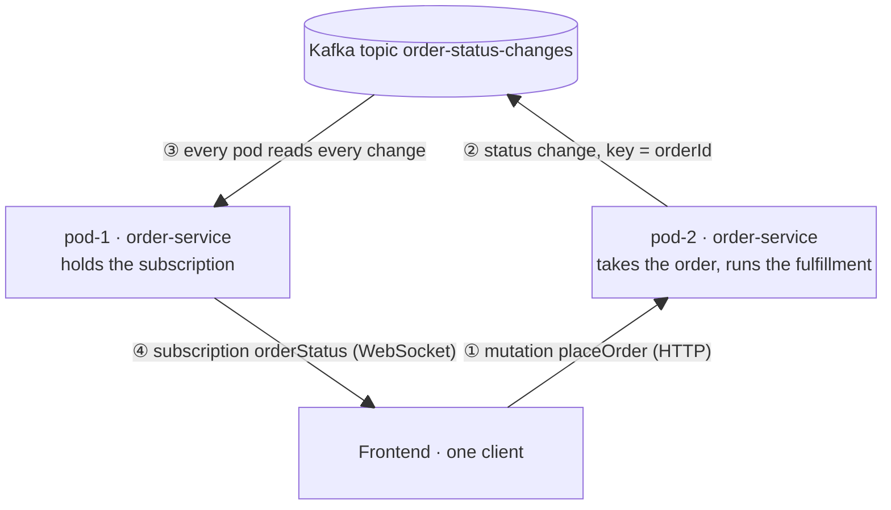

# 📡 GraphQL Subscriptions Across Several Pods: Embedded Fan-out via Kafka 🛰️

A GraphQL subscription is a long-lived WebSocket connection, and that connection ends on **exactly one pod**. As soon as
a service runs with more than one replica, this happens even with a single client: the load balancer sends the
client's HTTP requests to one pod and its WebSocket to another.

```
Frontend ──HTTP──────▶ pod-2   places the order, status changes happen here
Frontend ──WebSocket─▶ pod-1   holds the subscription for that order        ❓ how does pod-1 find out?
```

This example answers the question with Spring for GraphQL **inside the service itself**. Every pod publishes its
status changes to Kafka and reads **all** of them back, so each pod can notify the subscriptions connected to it.
There is no extra gateway and no extra process.

> The sibling example [`spring-for-graphql-subscriptions-sidecar`](../spring-for-graphql-subscriptions-sidecar/README.md)
> solves the same problem with a **sidecar** next to the service. Both expose the same GraphQL API and pass the same
> multi-pod test.

## ✨ Use-Case

An online shop with **one client**, the shop frontend. The customer places an order and then watches it progress
live. The order is placed with `placeOrder`, and the server assigns its id. After that, fulfillment (payment provider,
warehouse) moves it on asynchronously, step by step:

```
PLACED ──▶ PAYMENT_CONFIRMED ──▶ READY_TO_SHIP ──▶ SHIPPED
(response of placeOrder)        (via subscription orderStatus)
```

```graphql
type Query        { pod: String! }
type Mutation     { placeOrder(article: String!, quantity: Int!): Order! }
type Subscription { orderStatus(orderId: ID!): OrderStatusChange! }

type Order             { id: ID!  article: String!  quantity: Int!  status: OrderStatus!  placedOnPod: String! }
type OrderStatusChange { orderId: ID!  status: OrderStatus!  changedAt: String!  changedOnPod: String! }
```

Fulfillment is simulated by `SimulatedOrderFulfillmentAdapter`: it reports one step every `order-fulfillment.step-delay`
(10 s by default) on the pod that took the order. In a real system, these updates would arrive as a webhook or as a
Kafka event of another service, again on whichever pod. `placedOnPod`, `changedOnPod` and `Query.pod` are only there
for the demo: they show which pod did what.

## 🔁 How it works



1. The frontend places the order. The request lands on **pod-2**, which returns the order id and starts the fulfillment.
2. Every status change is published to Kafka, keyed by the order id. pod-2 does **not** notify anyone directly.
3. Every pod consumes the topic with its **own** consumer group, so **pod-1** gets the change too (and so does pod-2).
4. pod-1 pushes the change into the subscription the frontend opened with the order id.

Four building blocks make it work:

### 1. One consumer group per pod: broadcast instead of load balancing

Kafka delivers every record to **one consumer per consumer group**. If all replicas share one group, which is the
usual setup for work queues, only one random pod would see a status change. Here every pod has its **own** group,
so every pod gets every change:

```kotlin
@KafkaListener(
    id = LISTENER_ID,
    topics = ["\${order-status-changes.topic}"],
    groupId = "\${spring.application.name}-\${pod.name}",
)
fun onOrderStatusChange(payload: String)
```

`pod.name` comes from `POD_NAME`, which Kubernetes fills with the pod name via the Downward API
(see [`k8s/order-service.yaml`](k8s/order-service.yaml)). The log of the multi-pod test shows that each pod gets all
partitions:

```
order-service-pod-1: partitions assigned: [order-status-changes-0, order-status-changes-1, order-status-changes-2]
order-service-pod-2: partitions assigned: [order-status-changes-0, order-status-changes-1, order-status-changes-2]
```

`auto-offset-reset: latest` makes a new pod start at the end of the topic. Subscriptions are about *live* changes, so a
freshly started pod has nothing to replay.

### 2. Every change takes the same path, even on the pod where it happened

`ChangeOrderStatusService` only broadcasts:

```kotlin
val change = OrderStatusChange(update.orderId, update.status, Instant.now(), podName)
broadcast.broadcastToAllPods(change)
```

pod-2 receives its own change back from Kafka like every other pod. This keeps a single delivery path: no duplicates,
no special case for "local", and the same order on every pod, because all changes of an order share the key
(order id) and therefore the partition. The broadcast waits for the broker's ack (`send(...).join()`), so a change
that Kafka did not accept fails loudly instead of disappearing.

### 3. A local hub per pod

`LocalOrderSubscribersAdapter` is an in-memory `MutableSharedFlow`. The Kafka listener pushes every change into it, and
every open subscription collects from it, filtered by its order id:

```kotlin
private val changes = MutableSharedFlow<OrderStatusChange>(extraBufferCapacity = 256, onBufferOverflow = DROP_OLDEST)

override fun deliver(change: OrderStatusChange) { changes.tryEmit(change) }
override fun changesOf(orderId: OrderId) = changes.filter { it.orderId == orderId }
```

- `tryEmit` never blocks the Kafka listener. A slow WebSocket client loses its oldest buffered changes instead of
  slowing down all other subscriptions of the pod.
- A `SharedFlow` keeps no history, so a new subscription only sees changes that arrive after it started.

The controller returns a Kotlin `Flow`, which Spring for GraphQL adapts to a reactive stream
(`kotlinx-coroutines-reactor` has to be on the classpath):

```kotlin
@SubscriptionMapping
fun orderStatus(@Argument orderId: String): Flow<OrderStatusChangeDto> =
    query.trackOrderStatus(OrderId(orderId)).map { OrderStatusChangeDto.from(it) }
```

### 4. Ready only when the pod can receive changes

A pod that accepts subscriptions before its consumer owns partitions would silently miss changes.
`OrderStatusListenerHealthIndicator` reports `DOWN` until partitions are assigned, and it is part of the readiness group:

```yaml
management.endpoint.health.group.readiness.include: readinessState,orderStatusListener
```

Kubernetes therefore only routes WebSocket connections to a pod once it receives live changes. The tests rely on this
too.

## ⏱️ The gap between `placeOrder` and the subscription

The server assigns the order id, so the client can only subscribe **after** `placeOrder` has returned. A status change
that happens in between is not delivered, because the subscription does not exist yet and the hub keeps no history.

A real system closes the gap like this:

1. The order lives in a database that every pod can read.
2. After `placeOrder`, the client **first** opens the subscription and **then** loads the current status with a query.
3. Changes arriving via the subscription are only applied if they are newer than what the query returned.

The same steps apply to every reconnect, for example when a pod is replaced during a rolling update. This example has
no database on purpose. Instead, the simulated fulfillment waits one `step-delay` before its first step, which leaves
enough time to subscribe.

## 🚀 Run it

```bash
# 1. Kafka (podman or docker)
cd examples/spring-for-graphql-subscriptions-embedded && podman compose up -d

# 2. two pods of the same service, each in its own terminal
./gradlew :examples:spring-for-graphql-subscriptions-embedded:bootRun
./gradlew :examples:spring-for-graphql-subscriptions-embedded:bootRun --args='--server.port=8085 --pod.name=pod-2'

# 3. tests (incl. the multi-pod test against an embedded Kafka, no container needed)
./gradlew :examples:spring-for-graphql-subscriptions-embedded:test
```

Act as the frontend whose requests are spread across both pods. Place the order in GraphiQL of **pod-2**
(http://localhost:8085/graphiql):

```graphql
mutation {
  placeOrder(article: "Espresso machine", quantity: 1) { id status placedOnPod }
}
```

Within 10 seconds, subscribe with the returned id in GraphiQL of **pod-1** (http://localhost:8084/graphiql):

```graphql
subscription {
  orderStatus(orderId: "<id from placeOrder>") { status changedOnPod }
}
```

pod-1 streams every step, although all of them happened on pod-2:

```json
{ "orderStatus": { "status": "PAYMENT_CONFIRMED", "changedOnPod": "pod-2" } }
{ "orderStatus": { "status": "READY_TO_SHIP", "changedOnPod": "pod-2" } }
{ "orderStatus": { "status": "SHIPPED", "changedOnPod": "pod-2" } }
```

| Endpoint   | Path                                                               |
|------------|--------------------------------------------------------------------|
| HTTP       | `/api/graphql` (query, mutation)                                   |
| WebSocket  | `/api/graphql-ws` (subscription, `graphql-transport-ws` protocol) |
| GraphiQL   | `/graphiql`                                                        |
| Readiness  | `/actuator/health/readiness`                                       |

## 🧱 Hexagonal structure

Kafka, the simulated fulfillment and the in-memory hub sit behind outbound ports. The application layer knows none
of them.

| Inbound adapter                                | Inbound port                    | Service                         | Outbound port               | Outbound adapter                   |
|------------------------------------------------|---------------------------------|---------------------------------|-----------------------------|------------------------------------|
| `PlaceOrderController` (GraphQL mutation)      | `PlaceOrderUseCase`             | `PlaceOrderService`             | `OrderFulfillmentPort`      | `SimulatedOrderFulfillmentAdapter` |
| `FulfillmentUpdateListener` (fulfillment)      | `ChangeOrderStatusUseCase`      | `ChangeOrderStatusService`      | `OrderStatusBroadcastPort`  | `OrderStatusKafkaAdapter`          |
| `OrderStatusKafkaListener` (Kafka)             | `NotifyOrderSubscribersUseCase` | `NotifyOrderSubscribersService` | `LocalOrderSubscribersPort` | `LocalOrderSubscribersAdapter`     |
| `OrderStatusController` (GraphQL subscription) | `TrackOrderStatusQuery`         | `TrackOrderStatusService`       | `LocalOrderSubscribersPort` | `LocalOrderSubscribersAdapter`     |

The simulated fulfillment reports its updates as Spring application events (`FulfillmentUpdate`), and
`FulfillmentUpdateListener` picks them up like a webhook would.

Thanks to the ports, the sidecar variant exchanges only the two Kafka adapters for two HTTP adapters. Domain,
use-cases, GraphQL controllers, fulfillment and hub stay exactly the same.

## 🧪 Tests

| Test                                    | Proves                                                                                      |
|-----------------------------------------|---------------------------------------------------------------------------------------------|
| `MultiPodSubscriptionTest`              | two pods (two Spring contexts) + embedded Kafka: the client places an order on pod-2, subscribes on pod-1 and gets every status change. The same path works when both land on the same pod |
| `OrderStatusControllerTest`             | the subscription streams every status change of the order (`@GraphQlTest`)                   |
| `PlaceOrderControllerTest`              | the mutation returns the order with the id assigned by the server (`@GraphQlTest`)           |
| `LocalOrderSubscribersAdapterTest`      | fan-out to every subscription, filtering per order, no replay                                |
| `SimulatedOrderFulfillmentAdapterTest`  | fulfillment reports its steps in order                                                       |
| `PlaceOrderServiceTest`                 | a new order gets a new id and starts its fulfillment                                         |
| `ChangeOrderStatusServiceTest`          | a status change is only broadcast, never delivered locally directly                          |
| `ArchitectureTest`                      | the shared hexagonal rule set                                                                |

There is no Bruno collection for this example. The Bruno collections of the other examples only cover request/response
calls, while a subscription needs a WebSocket client, and the e2e job would need a Kafka broker on top.
`MultiPodSubscriptionTest` covers the e2e flow in `./gradlew build` instead.

## ⚖️ Trade-offs and production notes

- **At most once, live only.** A client that is not connected while a change happens does not get it later (see the
  gap between `placeOrder` and the subscription above). Use the subscription for changes, and a query for
  the current state.
- **Every pod reads every change.** Each pod consumes the full topic and filters in memory. That is cheap for
  notification-sized traffic. For very high volumes, use a dedicated, slim notification topic instead of the full
  domain event stream.
- **Consumer groups come and go with the pods.** Every new pod name creates a new group. Kafka removes empty groups
  after `offsets.retention.minutes` (7 days by default). Committed offsets are irrelevant here anyway, because a pod
  always starts at `latest`.
- **WebSockets and rolling updates.** When a pod stops, its subscriptions end. Clients must reconnect, and they land
  on another pod. Load balancer and ingress must allow WebSocket upgrades. Sticky sessions are **not** needed.
- **Other brokers work the same way.** What matters is broadcast semantics to every pod: Redis Pub/Sub, PostgreSQL
  `LISTEN/NOTIFY` and Hazelcast topics all provide it. Use the one you already run. Only `OrderStatusKafkaAdapter`
  and `OrderStatusKafkaListener` would change.
- **More than one service.** If several backends need this, extract the two Kafka adapters plus the hub into a shared
  library (a Spring Boot starter). That is the embedded counterpart to the reusable sidecar image.

## 🧭 Embedded or sidecar?

|                                          | Embedded (this example)                       | [Sidecar](../spring-for-graphql-subscriptions-sidecar/README.md) |
|------------------------------------------|-----------------------------------------------|-------------------------------------------------------------------|
| Processes per pod                        | 1                                             | 2 (service + event relay)                                         |
| Kafka client, config and credentials     | in every service                              | only in the sidecar                                               |
| Service needs to speak                   | Kafka                                         | HTTP on `localhost`                                               |
| Extra hops per change                    | none                                          | 2 × `localhost` HTTP                                              |
| Reuse across backends                    | shared library, same language                 | same sidecar image for every backend, any language                |
| Failure modes                            | one process                                   | service and sidecar fail independently                            |
| Local development and tests              | 1 process + Kafka, test runs in one JVM       | 2 processes per pod + Kafka, test starts the sidecar as a process |
