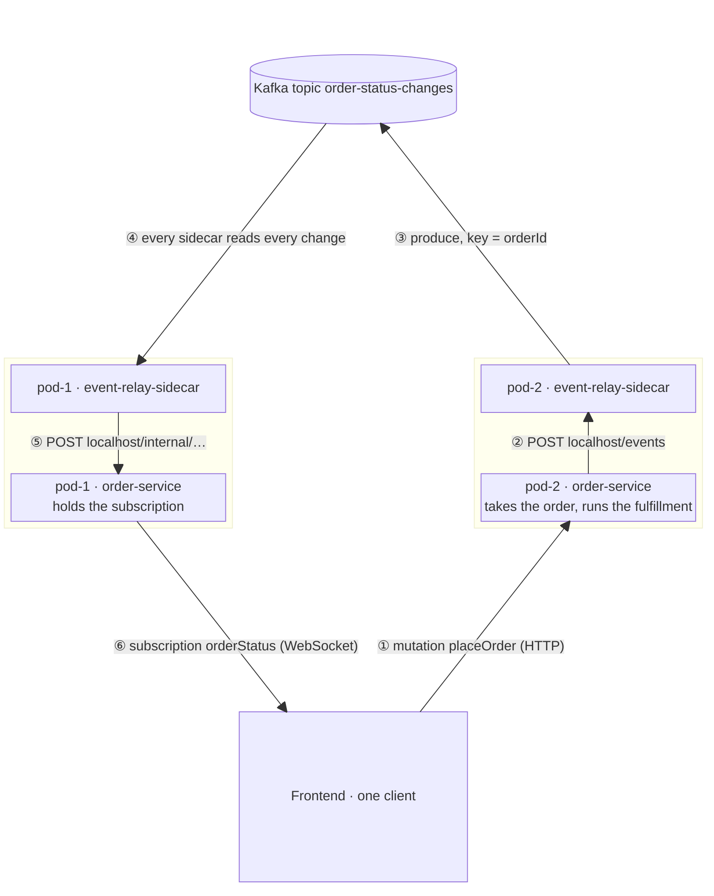

# 🛺 GraphQL Subscriptions Across Several Pods: Fan-out via a Sidecar 🛰️

A GraphQL subscription is a long-lived WebSocket connection, and that connection ends on **exactly one pod**. As soon as
a service runs with more than one replica, this happens even with a single client: the load balancer sends the
client's HTTP requests to one pod and its WebSocket to another.

```
Frontend ──HTTP──────▶ pod-2   places the order, status changes happen here
Frontend ──WebSocket─▶ pod-1   holds the subscription for that order        ❓ how does pod-1 find out?
```

This example keeps the subscriptions in the service (Spring for GraphQL), but moves the distribution across pods into
a **sidecar**: a second container in the same pod. The service knows nothing about Kafka. It only talks HTTP to
`localhost`.

> The sibling example [`spring-for-graphql-subscriptions-embedded`](../spring-for-graphql-subscriptions-embedded/README.md)
> solves the same problem **inside** the service. Both expose the same GraphQL API and pass the same multi-pod test.
> Use-case, the simulated fulfillment and the gap between `placeOrder` and the subscription are explained there in
> detail.

## 🧩 Two modules, one pod

| Module                                       | Role in the pod     | Knows                                   | Port (local) |
|----------------------------------------------|---------------------|-----------------------------------------|--------------|
| [`order-service`](order-service)             | the actual service  | GraphQL, the order domain, its sidecar  | 8086         |
| [`event-relay-sidecar`](event-relay-sidecar) | sidecar container   | Kafka, nothing about orders             | 8096         |



1. The frontend places the order. The request lands on **pod-2**, which returns the order id and starts the fulfillment.
2. Every status change is handed to pod-2's **own** sidecar: `POST http://localhost:8096/events?key=<orderId>`. The
   sidecar answers `202 Accepted` once Kafka acknowledged the record, so a change that could not be handed over fails
   loudly.
3. The sidecar publishes the payload **unchanged** to the topic, keyed by the order id.
4. Every sidecar consumes the topic with its **own** consumer group (`event-relay-sidecar-<pod name>`), so every pod
   gets every change. pod-2's sidecar gets it as well, it is just not drawn.
5. Every sidecar posts the change to **its own** service: `POST http://localhost:8086/internal/order-status-changes`.
6. The service pushes it into its local hub, and the frontend's subscription for that order receives it.

## ✨ API

The same API as the embedded example:

```graphql
type Query        { pod: String! }
type Mutation     { placeOrder(article: String!, quantity: Int!): Order! }
type Subscription { orderStatus(orderId: ID!): OrderStatusChange! }

type Order             { id: ID!  article: String!  quantity: Int!  status: OrderStatus!  placedOnPod: String! }
type OrderStatusChange { orderId: ID!  status: OrderStatus!  changedAt: String!  changedOnPod: String! }
```

`placeOrder` returns the order with status `PLACED`. The simulated fulfillment then reports `PAYMENT_CONFIRMED`,
`READY_TO_SHIP` and `SHIPPED`, one step every `order-fulfillment.step-delay` (10 s by default).

## 🚀 Run it

Two pods mean **four** processes locally: a service and a sidecar per pod.

```bash
# 1. Kafka (podman or docker)
cd examples/spring-for-graphql-subscriptions-sidecar && podman compose up -d

# 2. pod-1: sidecar on 8096, service on 8086 (the defaults)
./gradlew :examples:spring-for-graphql-subscriptions-sidecar:event-relay-sidecar:bootRun
./gradlew :examples:spring-for-graphql-subscriptions-sidecar:order-service:bootRun

# 3. pod-2: sidecar on 8097, service on 8087
./gradlew :examples:spring-for-graphql-subscriptions-sidecar:event-relay-sidecar:bootRun \
  --args='--server.port=8097 --pod.name=pod-2 --relay.delivery-url=http://localhost:8087/internal/order-status-changes'
./gradlew :examples:spring-for-graphql-subscriptions-sidecar:order-service:bootRun \
  --args='--server.port=8087 --pod.name=pod-2 --event-relay-sidecar.url=http://localhost:8097'

# tests of both modules (the multi-pod test starts the sidecars as real processes, no container needed)
./gradlew :examples:spring-for-graphql-subscriptions-sidecar:order-service:test \
          :examples:spring-for-graphql-subscriptions-sidecar:event-relay-sidecar:test
```

Place the order in GraphiQL of **pod-2** (http://localhost:8087/graphiql):

```graphql
mutation {
  placeOrder(article: "Espresso machine", quantity: 1) { id status placedOnPod }
}
```

Within 10 seconds, subscribe with the returned id in GraphiQL of **pod-1** (http://localhost:8086/graphiql):

```graphql
subscription {
  orderStatus(orderId: "<id from placeOrder>") { status changedOnPod }
}
```

pod-1 streams every step, although all of them happened on pod-2:

```json
{ "orderStatus": { "status": "PAYMENT_CONFIRMED", "changedOnPod": "pod-2" } }
{ "orderStatus": { "status": "READY_TO_SHIP", "changedOnPod": "pod-2" } }
{ "orderStatus": { "status": "SHIPPED", "changedOnPod": "pod-2" } }
```

## 🔌 The contract between service and sidecar

The whole coupling is two HTTP calls on `localhost`:

| Direction          | Call                                                                   | Body                      |
|--------------------|------------------------------------------------------------------------|---------------------------|
| service → sidecar  | `POST /events?key=<partition key>` → `202 Accepted`                    | any JSON, relayed as is   |
| sidecar → service  | `POST <relay.delivery-url>` (here `/internal/order-status-changes`)    | the same JSON             |

The sidecar is **domain-agnostic**. Its domain is a single `Event(key, payload)`. It never parses the payload. That
makes it reusable: every backend, in any language, gets cross-pod subscriptions by adding the same sidecar image with
a different `relay.topic` and `relay.delivery-url`. Kafka client, broker address and credentials live only in the
sidecar.

### Only two adapters differ from the embedded variant

`order-service` contains the same domain, use-cases, GraphQL controllers, simulated fulfillment and local hub
(`LocalOrderSubscribersAdapter`) as the embedded example. The hexagonal ports make the transport between pods
replaceable:

| Port                                       | Embedded                    | Sidecar                                                  |
|--------------------------------------------|-----------------------------|----------------------------------------------------------|
| `OrderStatusBroadcastPort` (outbound)      | `OrderStatusKafkaAdapter`   | `EventRelaySidecarAdapter` (POST to the sidecar)         |
| `NotifyOrderSubscribersUseCase` (inbound)  | `OrderStatusKafkaListener`  | `OrderStatusEventController` (POST from the sidecar)     |

### Structure of the sidecar

| Inbound adapter                       | Inbound port           | Service               | Outbound port          | Outbound adapter          |
|---------------------------------------|------------------------|-----------------------|------------------------|---------------------------|
| `EventController` (`POST /events`)    | `PublishEventUseCase`  | `PublishEventService` | `MessageBrokerPort`    | `KafkaBrokerAdapter`      |
| `BrokerEventListener` (Kafka)         | `DeliverEventUseCase`  | `DeliverEventService` | `LocalApplicationPort` | `LocalApplicationAdapter` |

Like in the embedded variant, `BrokerEventListenerHealthIndicator` keeps the sidecar **not ready** until its consumer
owns partitions. Since a pod is only ready when all its containers are ready, Kubernetes does not route WebSocket
connections to a pod that would miss changes.

## ☸️ Deployment

[`k8s/order-service.yaml`](k8s/order-service.yaml) runs the sidecar as a
[native sidecar](https://kubernetes.io/docs/concepts/workloads/pods/sidecar-containers/), which is an init container
with `restartPolicy: Always`. Kubernetes then starts the sidecar **before** the service and stops it **after** the
service, so the service can always hand over its changes. Both containers get the pod name via the Downward API
(`POD_NAME`), which makes the consumer group unique per pod.

The service exposes `/internal/order-status-changes` on its regular port, because the sidecar calls it via
`localhost`. Block `/internal/**` at the ingress, so nobody outside the pod can inject status changes.

## 🧪 Tests

| Test (module)                                         | Proves                                                                         |
|-------------------------------------------------------|--------------------------------------------------------------------------------|
| `MultiPodSubscriptionTest` (`order-service`)          | two pods, each made of a service (Spring context) and a sidecar (**separate JVM process** started from the sidecar's boot jar), plus an embedded Kafka: the client places an order on pod-2, subscribes on pod-1 and gets every status change. The same path works when both land on the same pod |
| `EventRelaySidecarAdapterTest` (`order-service`)      | the change is posted to the sidecar keyed by order id, and a failing sidecar fails the change |
| `EventRelayIntegrationTest` (`event-relay-sidecar`)   | `POST /events` goes through Kafka and comes back to the local application unchanged |
| `LocalApplicationAdapterTest` (`event-relay-sidecar`) | the payload is posted to the service as is                                     |
| `ArchitectureTest` (both)                             | the shared hexagonal rule set                                                  |

`order-service` additionally contains the same slice and unit tests as the embedded example.

The sidecar runs as a real process in the multi-pod test on purpose: in a pod it is a separate container too, and
running it inside the test JVM would mix two Spring Boot applications on one classpath. `order-service/build.gradle.kts`
resolves the sidecar's boot jar via the `bootArchives` configuration and hands its path to the test. Each sidecar logs
to `order-service/build/event-relay-sidecar-<pod>.log`.

## ⚖️ Trade-offs and production notes

- **At most once, live only.** A client that is not connected while a change happens does not get it later. After
  (re)connecting, the client should subscribe first and then load the current status with a query, as described in
  the embedded example.
- **Delivery to the service can fail.** If the service is not reachable, the sidecar's Kafka listener throws. Spring
  Kafka's default error handler retries a few times and then skips the record, so the subscriptions of that pod miss
  this change. That is acceptable for live notifications. Do not use the relay for anything that must be processed.
- **One more process to operate.** CPU and memory requests for each replica, a second image to build, scan and update,
  and a versioned HTTP contract between both containers. A crashed sidecar is restarted by Kubernetes, but changes in
  between are lost for that pod.
- **Two extra hops per change**, both on `localhost`. They are cheap, but not free.
- **Ready-made alternative: [Dapr](https://docs.dapr.io/developing-applications/building-blocks/pubsub/).** The Dapr
  sidecar offers the same contract (publish via `localhost`, delivery via an HTTP callback) for many brokers. Mind the
  default: Dapr uses the app id as consumer group, which load-balances events across the replicas. For subscriptions
  you need a broadcast, so set `consumerID: "{podName}"` in the Kafka pub/sub component.

## 🧭 Embedded or sidecar?

|                                          | [Embedded](../spring-for-graphql-subscriptions-embedded/README.md) | Sidecar (this example)                                 |
|------------------------------------------|---------------------------------------------------------------------|--------------------------------------------------------|
| Processes per pod                        | 1                                                                   | 2 (service + event relay)                              |
| Kafka client, config and credentials     | in every service                                                    | only in the sidecar                                    |
| Service needs to speak                   | Kafka                                                               | HTTP on `localhost`                                    |
| Extra hops per change                    | none                                                                | 2 × `localhost` HTTP                                   |
| Reuse across backends                    | shared library, same language                                       | same sidecar image for every backend, any language     |
| Failure modes                            | one process                                                         | service and sidecar fail independently                 |
| Local development and tests              | 1 process + Kafka, test runs in one JVM                             | 2 processes per pod + Kafka, test starts the sidecar as a process |
