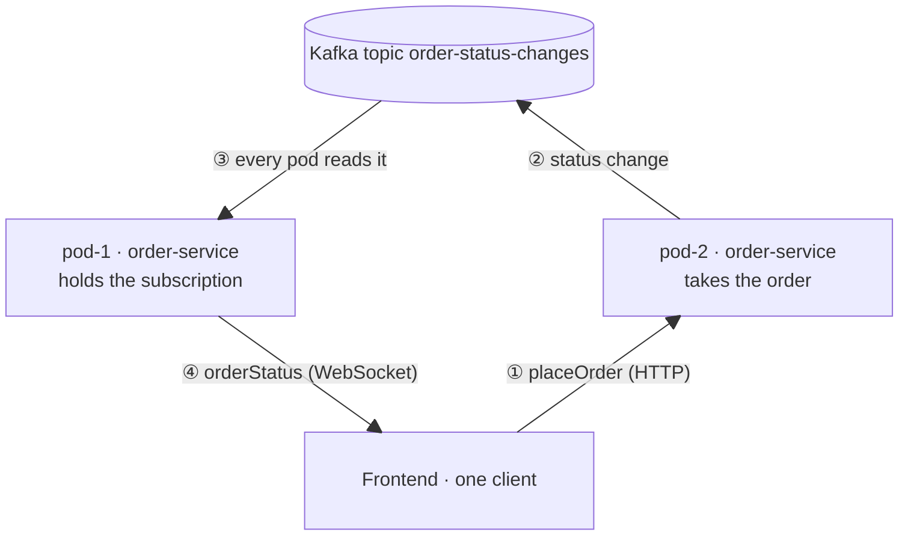
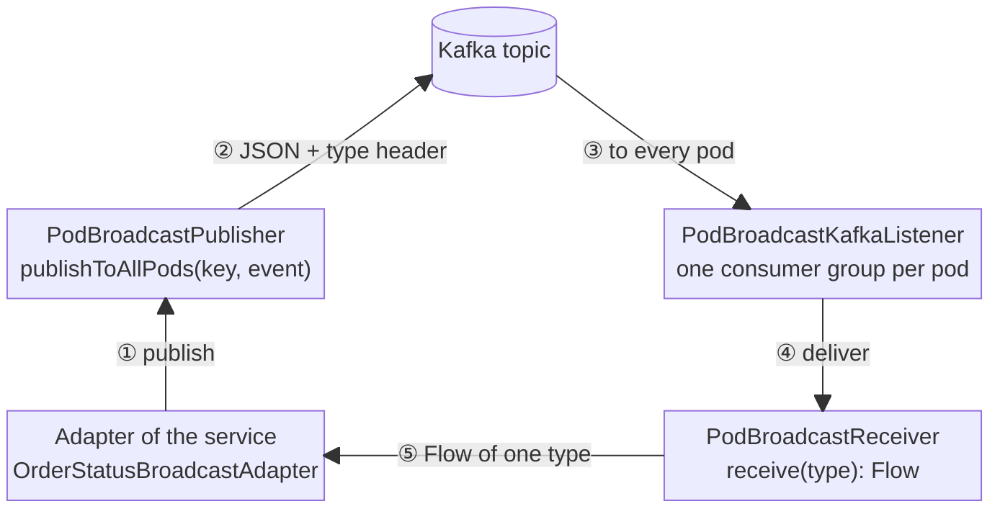

# 📡 GraphQL Subscriptions Across Several Pods 🛰️

A GraphQL subscription is a WebSocket, and a WebSocket ends on **one pod**. With several replicas, a client's HTTP
request can land on pod-2 and its WebSocket on pod-1. When something changes on pod-2, pod-1 has to find out.

This example solves it with Spring for GraphQL **inside the service**: every pod publishes its changes to Kafka and
reads the changes of **all** pods back. The Kafka part is generic, so it lives in a small Spring Boot starter.

| Module                                           | Contains                                                         |
|--------------------------------------------------|------------------------------------------------------------------|
| [`pod-broadcast-starter`](pod-broadcast-starter) | send an event to all pods, receive the events of all pods        |
| [`order-service`](order-service)                 | GraphQL API and order domain, uses the starter in one adapter    |

## ✨ Use-Case

One frontend places an order and watches its status live. The server assigns the order id. A simulated fulfillment
then moves the order on every 10 seconds, on the pod that took it:

```
PLACED ──▶ PAYMENT_CONFIRMED ──▶ READY_TO_SHIP ──▶ SHIPPED
(placeOrder)             (subscription orderStatus)
```

```graphql
type Mutation     { placeOrder(article: String!, quantity: Int!): Order! }
type Subscription { orderStatus(orderId: ID!): OrderStatusChange! }
```

## 🔁 How it works



1. The order lands on pod-2, which returns the id and starts the fulfillment.
2. Every status change goes to Kafka, keyed by the order id. pod-2 notifies nobody directly.
3. Every pod reads the topic with its **own** consumer group, so every pod gets every change.
4. pod-1 pushes the change into the subscription of the frontend.

## ⚙️ Inside the starter



| Class                         | Job                                                                                  |
|-------------------------------|--------------------------------------------------------------------------------------|
| `PodBroadcastPublisher`       | sends an event to all pods and waits for Kafka's ack                                 |
| `PodBroadcastKafkaListener`   | reads the topic with the consumer group `<app>-<pod-name>`, from `latest`            |
| `PodBroadcastReceiver`        | in-memory `SharedFlow`, `receive<T>()` streams the events of type `T`                |
| `PodBroadcastHealthIndicator` | `podBroadcast` is `DOWN` until the listener has partitions, so the pod is not ready  |

Three rules make it reliable:

- **One consumer group per pod.** With a shared group, Kafka would hand each event to only one pod.
- **One path for every event.** The sending pod receives its own event back from Kafka, like every other pod. No
  duplicates, no special case, and the same order everywhere, because one key means one partition.
- **Ready only when receiving.** A pod gets WebSocket traffic only once its listener owns partitions.

## 🧩 Using it in a service

```kotlin
implementation(project(":examples:spring-for-graphql-subscriptions:pod-broadcast-starter"))
```

```yaml
pod-broadcast:
  pod-name: ${POD_NAME:pod-1}   # unique per pod, Kubernetes fills POD_NAME via the Downward API
  topic: order-status-changes

management.endpoint.health.group.readiness.include: readinessState,podBroadcast
```

```kotlin
override fun broadcastToAllPods(change: OrderStatusChange) =
    publisher.publishToAllPods(change.orderId.value, OrderStatusChangeMessage.from(change))

override fun changesOf(orderId: OrderId) =
    receiver.receive<OrderStatusChangeMessage>().filter { it.orderId == orderId.value }.map { it.toDomain() }
```

The `@SubscriptionMapping` returns this `Flow` (needs `kotlinx-coroutines-reactor`). Everything else in the
order-service is plain hexagonal code: controllers, use-cases, domain, and the simulated fulfillment.

## 🚀 Run it

```bash
cd examples/spring-for-graphql-subscriptions && podman compose up -d     # Kafka

./gradlew :examples:spring-for-graphql-subscriptions:order-service:bootRun                                               # pod-1, port 8084
./gradlew :examples:spring-for-graphql-subscriptions:order-service:bootRun --args='--server.port=8085 --pod.name=pod-2'  # pod-2
```

Place an order on pod-2 (http://localhost:8085/graphiql):

```graphql
mutation { placeOrder(article: "Espresso machine", quantity: 1) { id } }
```

Within 10 seconds, subscribe on pod-1 (http://localhost:8084/graphiql). Every change arrives, although it happened
on pod-2:

```graphql
subscription { orderStatus(orderId: "<id>") { status changedOnPod } }
```

## 🧪 Tests

Both multi-pod tests start two Spring contexts against an embedded Kafka, so they need no container and run in
`./gradlew build`.

| Test                       | Proves                                                                                       |
|----------------------------|----------------------------------------------------------------------------------------------|
| `PodBroadcastTest`         | an event published on one pod reaches every pod; a receiver only gets its type               |
| `MultiPodSubscriptionTest` | order on pod-2, subscription on pod-1 (and on the same pod): every status change arrives      |
| other tests                | GraphQL slices, adapters, services, and the shared hexagonal architecture rules             |

## ⚖️ Good to know

- **Live only.** A change that happens while no subscription is open is lost. Between `placeOrder` and the
  subscription there is such a gap. A real system subscribes first and then queries the current status from its
  database. This example has no database, so the fulfillment simply waits 10 seconds before its first step.
- **Every pod reads everything.** Fine for notification-sized events. For big volumes, use a slim notification topic.
- **Reconnects.** When a pod stops, its subscriptions end and the clients reconnect to another pod. No sticky sessions.
- **Other brokers.** Anything with broadcast semantics works, e.g. Redis Pub/Sub or PostgreSQL `LISTEN/NOTIFY`. Only
  the starter would change.
- **Why not a sidecar?** A sidecar container would do the same, but pays off only for services in different languages.
  For Spring services, the starter is simpler: one process, one log, one JVM in the tests.
